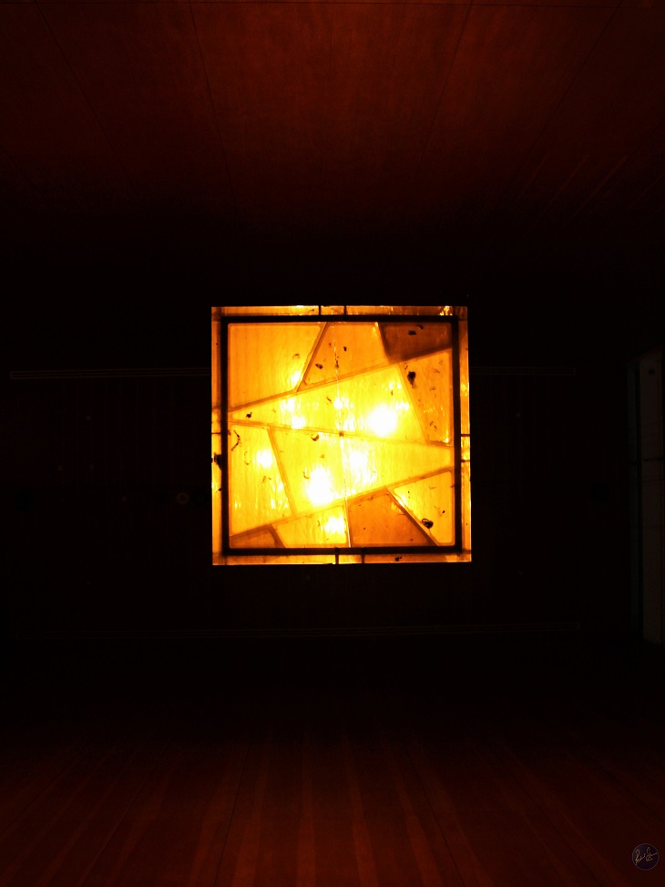

# the-aperture

<!-- PROJECT SHIELDS -->
<!--
*** I'm using markdown "reference style" links for readability.
*** Reference links are enclosed in brackets [ ] instead of parentheses ( ).
*** See the bottom of this document for the declaration of the reference variables
*** for contributors-url, forks-url, etc. This is an optional, concise syntax you may use.
*** https://www.markdownguide.org/basic-syntax/#reference-style-links
-->

<!--[![Contributors][contributors-shield]][contributors-url]
[![Forks][forks-shield]][forks-url]
[![Stargazers][stars-shield]][stars-url]
[![Issues][issues-shield]][issues-url]
[![MIT License][license-shield]][license-url] -->
[![LinkedIn][linkedin-shield]][linkedin-url]

<!-- PROJECT LOGO -->

  

  <h3 align="center">The Aperture</h3>

  

    A dedicated place for my photos.
     
    <a href="https://github.com/rahul-sha/the-aperture"><strong>Explore the docs »</strong></a>
     
        <!--
    <a href="https://github.com/rahul-sha/the-aperture">View Demo</a>
    ·
    <a href="https://github.com/rahul-sha/the-aperture/issues">Report Bug</a>
    ·
    <a href="https://github.com/rahul-sha/the-aperture/issues">Request Feature</a>-->
  

<!-- TABLE OF CONTENTS -->
## Table of Contents

* [About the Project](#about-the-project)
* [Usage](#usage)
* [Roadmap](#roadmap)
* [Contact](#contact)

<!-- ABOUT THE PROJECT -->
## About The Project

Hello, this is not a project more or less an interest to move my portfolio from wix to a custom made website with images hosted here. **Not sure if it's worth using github in the sense that bandwidths might restricted to host images.** For the time being, no significant progress expected.

<!--### Built With

* 
* 
* 

<!-- USAGE EXAMPLES -->
## Usage

More or less a typical css made website.

<!-- ROADMAP -->
## Roadmap (Pending)

See the [open issues](https://github.com/rahul-sha/the-aperture/issues) for a list of proposed features (and known issues).

<!-- CONTACT -->
## Contact

Rahul Sharma - [@xo_rahul](https://twitter.com/xo_rahul) - rahulsharma@outlook.sg

Project Link: [https://github.com/rahul-sha/the-aperture](https://github.com/rahul-sha/the-aperture)

<!-- MARKDOWN LINKS & IMAGES -->
<!-- https://www.markdownguide.org/basic-syntax/#reference-style-links -->
[contributors-shield]: https://img.shields.io/github/contributors/rahul-sha/repo.svg?style=flat-square
[contributors-url]: https://github.com/rahul-sha/repo/graphs/contributors
[forks-shield]: https://img.shields.io/github/forks/rahul-sha/repo.svg?style=flat-square
[forks-url]: https://github.com/rahul-sha/repo/network/members
[stars-shield]: https://img.shields.io/github/stars/rahul-sha/repo.svg?style=flat-square
[stars-url]: https://github.com/rahul-sha/repo/stargazers
[issues-shield]: https://img.shields.io/github/issues/rahul-sha/repo.svg?style=flat-square
[issues-url]: https://github.com/rahul-sha/repo/issues
[license-shield]: https://img.shields.io/github/license/rahul-sha/repo.svg?style=flat-square
[license-url]: https://github.com/rahul-sha/repo/blob/master/LICENSE.txt
[linkedin-shield]: https://img.shields.io/badge/-LinkedIn-black.svg?style=flat-square&logo=linkedin&colorB=555
[linkedin-url]: https://linkedin.com/in/rahul-sha
[product-screenshot]: images/screenshot.png